# Latent Space Explorer

### Clustering and Dimensionality Reduction for Latent Feature Visualization

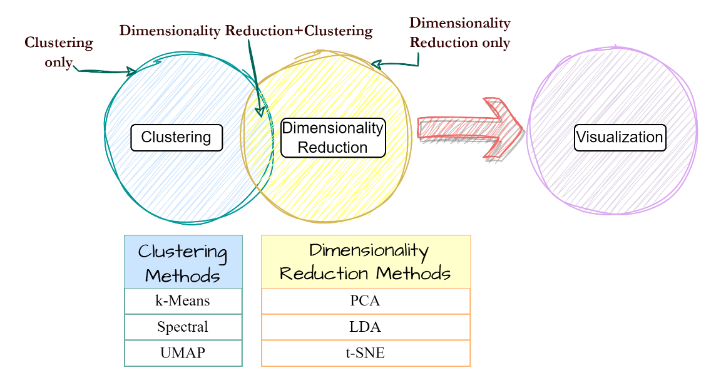

## 1. Project Overview

This project explores different clustering and dimensionality-reduction
techniques for visualizing and interpreting latent feature
representations extracted from a neural network.

It was developed as an academic project during the first semester of my
MSc in Artificial Intelligence for Industrial Applications at OTH
Amberg-Weiden (Winter Semester 2023).

The objective was to investigate different approaches for presenting,
comparing and evaluating latent bottleneck feature vectors from a given
network, and to develop an experimental software toolkit offering a
selection of existing clustering and visualization techniques.

## 2. Motivation and Goals

Neural networks can produce high-dimensional latent or embedded feature
representations. In this experiment, the feature vectors had **1,696
dimensions**, which made direct visualization difficult.

The original project focused on three goals:

-   **Explore:** Apply different clustering and dimensionality-reduction
    techniques to latent feature representations.
-   **Compare:** Plot and compare the resulting algorithm-specific
    representations.
-   **Develop a toolkit:** Provide an experimental framework with a
    selection of clustering and visualization techniques for incoming
    latent or embedded feature representations.

## 3. Methods

The experiment combined four dimensionality-reduction techniques with two clustering algorithms.

### 3.1 Dimensionality Reduction

| Technique | Description |
|---|---|
| **PCA** | Principal Component Analysis; a linear dimensionality-reduction technique. |
| **LDA** | Linear Discriminant Analysis; a supervised technique that uses class labels. |
| **UMAP** | Uniform Manifold Approximation and Projection; a nonlinear dimensionality-reduction technique. |
| **t-SNE** | t-distributed Stochastic Neighbor Embedding; a nonlinear technique commonly used to visualize high-dimensional data. |

### 3.2 Clustering

| Algorithm | Description |
|---|---|
| **K-Means** | Groups feature vectors into a predefined number of clusters. |
| **Spectral Clustering** | Uses relationships between data points to identify clusters. |

### 3.3 Experimental Combinations

Each dimensionality-reduction technique was combined with both clustering algorithms, resulting in eight combinations:

| Dimensionality-reduction technique | Clustering algorithms |
|---|---|
| PCA | K-Means, Spectral Clustering |
| LDA | K-Means, Spectral Clustering |
| UMAP | K-Means, Spectral Clustering |
| t-SNE | K-Means, Spectral Clustering |

## 4. Experimental Workflow

The experimental workflow was:

1.  Load pre-extracted feature representations from PyTorch `.pt` files.
2.  Organize the feature vectors according to their classes.
3.  Apply a dimensionality-reduction technique.
4.  Apply a clustering algorithm to the reduced representation.
5.  Visualize the resulting two-dimensional feature space and cluster
    assignments.
6.  Evaluate the clustering results using the average silhouette score
    and record processing time.

The original experiment also evaluated clustering on the
high-dimensional feature vectors. Since these vectors had 1,696
dimensions, the clustering output did not provide a direct
two-dimensional visualization. Dimensionality reduction was used to make
the feature-space structure visually inspectable.

## 5. Experimental Results

The following values are transcribed from the original project results
summary.
### 5.1 Clustering on the Original Feature Vectors

The results summary reports the following values for clustering without first applying dimensionality reduction:

| Clustering algorithm | Reported value |
|---|---:|
| K-Means | 0.2648 |
| Spectral Clustering | 0.2675 |

### 5.2 Dimensionality-Reduction Visualizations

The following plots show the feature representations after applying
the four dimensionality-reduction techniques.

| PCA | LDA |
|:---:|:---:|
| 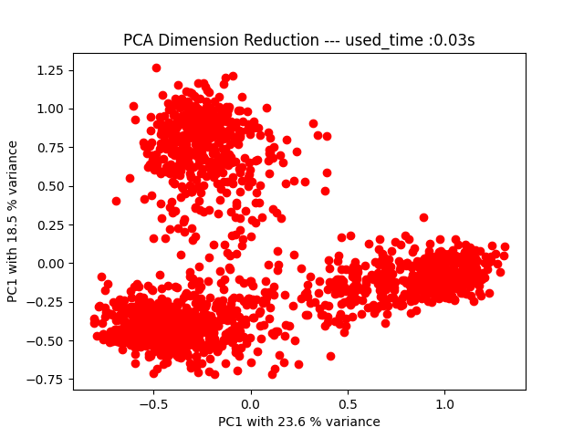 | 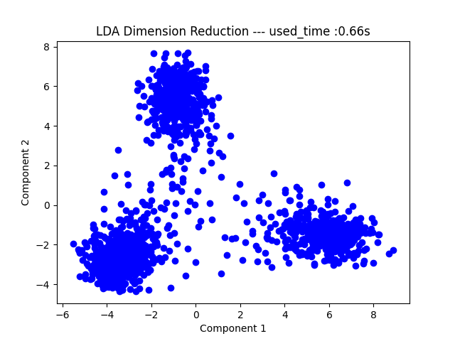 |

| UMAP | t-SNE |
|:---:|:---:|
| 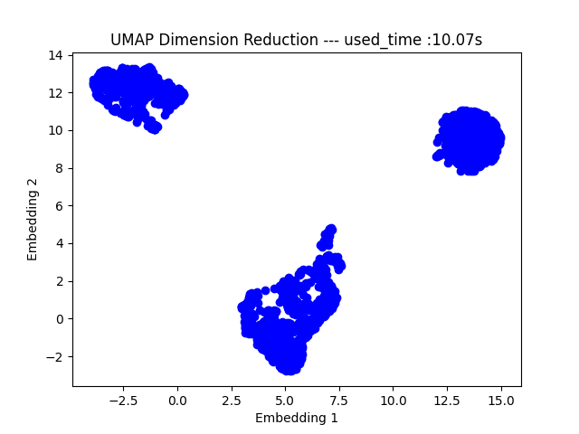 | 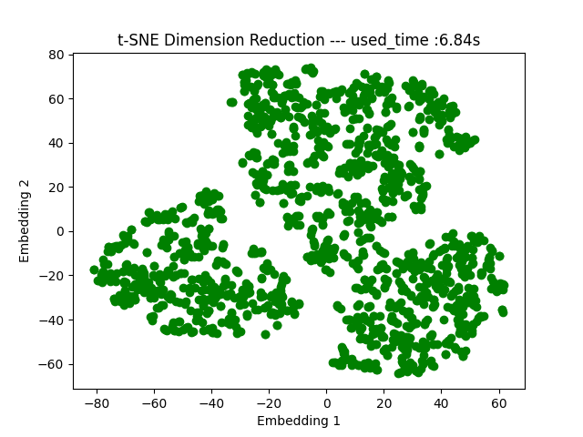 |

### 5.3 Clustering Combined with Dimensionality Reduction

The following visualizations show the cluster assignments obtained
when applying K-Means and Spectral Clustering to each reduced
feature representation.

#### PCA

| K-Means | Spectral Clustering |
|:---:|:---:|
| 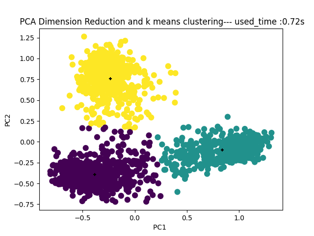 | 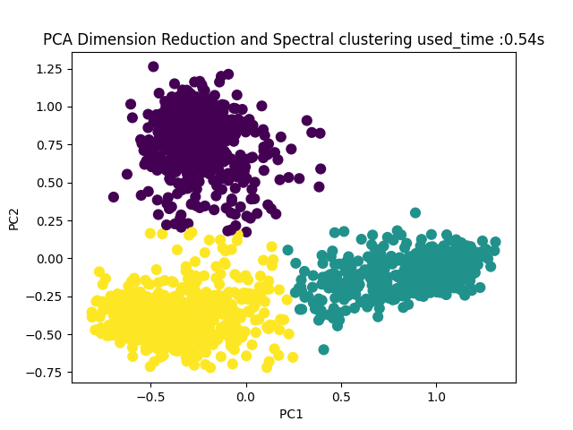 |

#### LDA

| K-Means | Spectral Clustering |
|:---:|:---:|
| 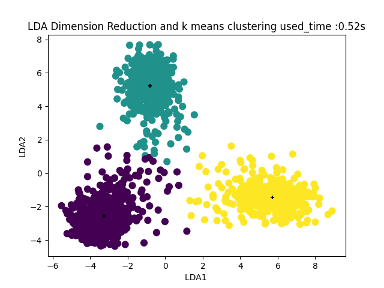 | 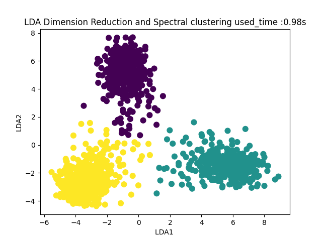 |

#### UMAP

| K-Means | Spectral Clustering |
|:---:|:---:|
| 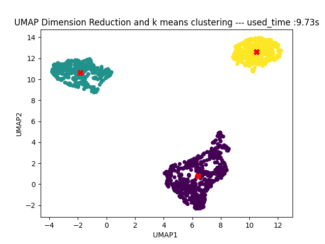 | 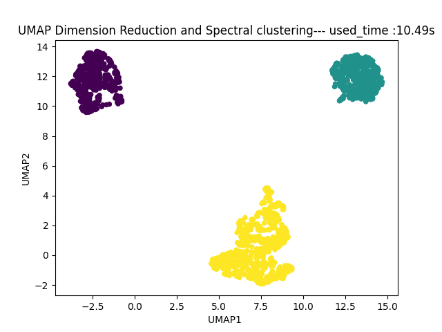 |

#### t-SNE

| K-Means | Spectral Clustering |
|:---:|:---:|
| 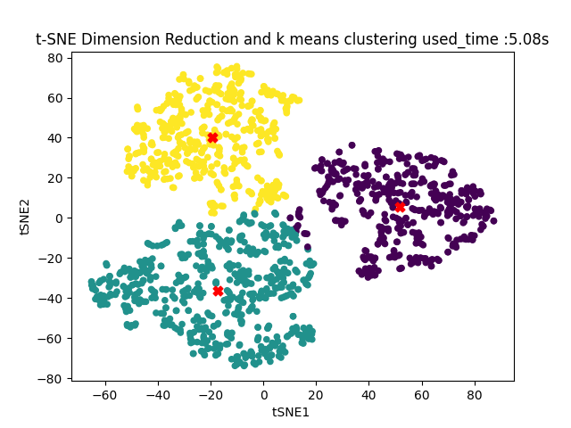 | 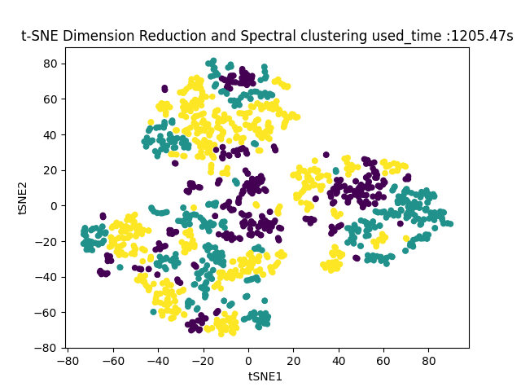 |

The plots allow the cluster assignments to be inspected in the reduced
feature spaces.

### 5.4 Average Silhouette Scores

The original results summary reports the following average silhouette scores for the combinations of dimensionality-reduction and clustering methods:

| Clustering algorithm | PCA | LDA | UMAP | t-SNE |
|---|---:|---:|---:|---:|
| K-Means | 0.2647 | 0.2597 | 0.2642 | 0.2502 |
| Spectral Clustering | 0.2647 | 0.2593 | 0.2644 | 0.0060 |

**Observations from the reported values:**

-   For K-Means, the reported scores are relatively close across the
    four dimensionality-reduction methods, ranging from 0.2502 to
    0.2647.
-   PCA with K-Means has the highest reported score in this table
    (0.2647), narrowly followed by UMAP with K-Means (0.2642).
-   For Spectral Clustering, PCA and UMAP have similar reported scores
    (0.2647 and 0.2644), while the t-SNE combination has a substantially
    lower reported score (0.0060).
-   These observations apply only to the reported experiment. They do
    not establish that the same ranking would hold for other datasets,
    feature extractors or parameter settings.

### 5.5 Processing Time

The original summary reports the following processing times in seconds:

| Clustering method | PCA (s) | LDA (s) | UMAP (s) | t-SNE (s) |
|---|---:|---:|---:|---:|
| No clustering | 0.03 | 0.66 | 10.07 | 6.84 |
| K-Means | 0.72 | 0.52 | 9.73 | 5.08 |
| Spectral Clustering | 0.54 | 0.98 | 10.9 | 1,205.47 |      

**Observations from the reported timings:**

-   PCA has the lowest dimensionality-reduction-only time in the
    reported results (0.03 seconds).
-   UMAP takes 10.07 seconds when used without clustering in this
    experiment.
-   The reported t-SNE plus Spectral Clustering combination takes
    1,205.47 seconds, approximately 20.1 minutes, which is substantially
    longer than the other reported combinations.
-   Processing times are specific to the original execution environment,
    dataset and implementation. They should not be treated as general
    performance benchmarks.

## 6. Technologies Used

The original implementation uses the following technologies and
libraries:

-   Python
-   PyTorch
-   NumPy
-   scikit-learn
-   Matplotlib
-   UMAP-learn
-   Jupyter Notebook

## 7. Repository Structure

```text
latent-space-explorer/
│
├── original_work/
│   ├── Clustering_DR_Library.py
│   ├── Clustering_DR_Runner.py
│   └── Dissanayake_Ishara.ipynb
│
├── data/
│   └── README.md
│
├── results/
│   ├── figures/
│   │   ├── overview.png
│   │   ├── dimensionality_reduction/
│   │   └── clustering_combinations/
│   └── Results-summery.pdf
│
├── docs/
│   ├── project_overview.md
│   └── development_notes.md
│
├── README.md
├── requirements.txt
└── .gitignore
```

The feature dataset is not included in this repository. Refer to
`data/README.md` for the expected input structure and dataset placement
instructions.

## 8. Scope and Limitations

This repository presents an academic experiment focused on applying and
comparing selected dimensionality-reduction and clustering techniques to
latent feature representations.

It is not intended to be a production-ready machine-learning framework.
The reported results are tied to the original dataset, implementation,
parameters and execution environment. In particular:

-   LDA is supervised and uses class labels, unlike the other
    dimensionality-reduction methods in this experiment.
-   Two-dimensional plots are visual projections of the feature data and
    may not preserve every aspect of the original high-dimensional
    structure.
-   The reported processing times are environment-dependent.

## 9. Revisiting the Project

The original implementation is preserved as the record of the academic
work completed during the first semester of my MSc. Any later
corrections, clarifications or documentation improvements will be kept
separate from that original version.

Revisiting the experiment provides an opportunity to review the
implementation, examine its limitations and reflect on how my
understanding of machine-learning workflows and Python development has
evolved.

---

**Academic project:** MSc Artificial Intelligence for Industrial
Applications\
**Institution:** OTH Amberg-Weiden\
**Original development:** Winter Semester 2023\
**Author:** Ishara Dissanayake
