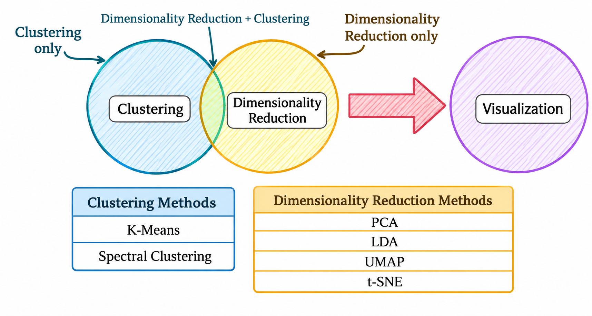

# Project Overview

## Purpose

Latent Space Explorer is an academic experiment investigating how clustering and dimensionality-reduction techniques can be applied to high-dimensional latent feature representations and visualized in a two-dimensional feature space.

The experiment considers three possible workflows:

1. **Clustering only** – apply a clustering algorithm directly to the original feature representations.
2. **Dimensionality reduction followed by clustering** – reduce the dimensionality of the feature representations and then apply a clustering algorithm to the reduced data.
3. **Dimensionality reduction only** – reduce the dimensionality of the feature representations to support visual exploration, without applying a clustering algorithm afterwards.

## Methods considered

The project evaluates the following methods:

| Category | Methods |
|---|---|
| Clustering | K-Means, Spectral Clustering |
| Dimensionality reduction | PCA, LDA, UMAP, t-SNE |

The dimensionality-reduction methods are used to transform the original feature representations into a lower-dimensional space for visualization. The clustering methods assign cluster labels to the input representations.

## Experimental combinations

The experiment combines each of the four dimensionality-reduction methods with each of the two clustering algorithms, resulting in eight dimensionality-reduction-plus-clustering combinations.

The results are explored through visualizations and evaluated using average silhouette scores and recorded processing times.

## Overview diagram

The diagram below summarizes the three workflows considered in the project.

